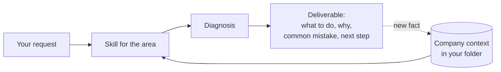

<div align="center">

**English** · [Português (Brasil)](docs/readme/README_pt-BR.md)

# business-ops

### A plugin for running your company's business work with Claude Code and Codex.

**Tell it about your company once. Every skill starts from that context.**

[](#quick-start)
[](#quick-start)
[](#what-you-can-do)
[](#faq)
[](LICENSE)
[](CHANGELOG.md)

[Quick start](#quick-start) · [How it works](#how-it-works) · [What you can do](#what-you-can-do) · [Example requests](#example-requests) · [FAQ](#faq) · [Documentation](#documentation)

<code>claude plugin marketplace add pv-ca/business-ops &amp;&amp; claude plugin install business-ops@pvca</code>

</div>

---

Need to answer a lead, write a proposal, plan next month's content, or find out why customers cancel? Ask your agent. business-ops gives it the method for each area and the context of your company, and the answer arrives the way a coach would give it: what to do, why, the common mistake, and the next step.

The plugin has 22 skills for sales, customer success, marketing, social media, processes, finance and management. On first use it asks about you and what the company sells, and saves the answers as Markdown files in a folder on your computer. If you run more than one company, each gets its own folder, and the plugin does not carry a price, a customer or a practice from one to another.

Anything written for your customers uses only what you have confirmed. Each fact about the company carries one of five statuses (confirmed, represented, planned, hypothesis or unknown), and plans and prices come from a catalog that records whether each one is available.

> The plugin is a draft in use by its author, and this repository is private for now.

## Quick start

### Install it in your agent

Claude Code:

```bash
claude plugin marketplace add pv-ca/business-ops
claude plugin install business-ops@pvca
```

Codex:

```bash
codex plugin marketplace add pv-ca/business-ops
codex plugin add business-ops@pvca
```

Start a new session afterward. While the repository is private, installing requires access to it.

### Say where the context lives

In Claude Code, set the folder that will hold your company files:

```bash
claude plugin configure business-ops@pvca
```

In Codex, write the path to a file:

```bash
mkdir -p ~/.config/business-ops
echo /absolute/path/to/folder > ~/.config/business-ops/context-folder
```

With neither set, the plugin uses the folder named in the instructions of the project you are working in, and then the current directory.

### Tell it about your company

```text
I want to set up the context for my company.
```

The `business-context` skill talks in short blocks, at most three questions at a time: your role, what the company sells and to whom, its stage, the main difficulty today, and how well you know each area. If you have a document that already describes the company, share it and the skill reads it before asking.

### Ask your agent

```text
A lead asked for the price and went quiet after I answered. How do I pick the conversation back up?
```

Skills trigger from the request itself. You can also call one by name: `/business-ops:sales` in Claude Code, `$sales` in Codex.

### Update

```bash
claude plugin marketplace update pvca
claude plugin update business-ops@pvca
```

In Codex, run `codex plugin add business-ops@pvca` again. Changes apply from a new session. The [changelog](CHANGELOG.md) lists what changed in each version.

## How it works

Your agent receives the request and picks the skill for that area. Before answering, the skill reads your profile and the files of the company in question, follows a protocol shared by every skill, and then applies the method.



The protocol settles four things. The first is what may be claimed: customer-facing material uses confirmed facts and catalog entries marked as available. The second is the order of work, with diagnosis before recommendation and one primary recommendation that carries its first action and the criterion that shows whether it worked. The third is depth, set by the level you reported for each area. The fourth is the limit on actions: sending a message, publishing, spending money or making a commitment on your behalf needs your go-ahead for that action, so the plugin hands you the text ready to copy and you send it.

When you mention something new, such as a launch or a price change, the skill records it in the right file with the date.

## What you can do

| Area | What you get | Skill |
| --- | --- | --- |
| Context | Your profile and a set of files per company, updated when something changes | `business-context` |
| Sales | Replies to leads, conversation and demo scripts, follow-ups, answers to price objections | `sales` |
| Recurring revenue | Funnel, metrics, role split and an assessment of when to scale | `recurring-revenue` |
| Customer success | Onboarding plan, follow-up, reply to a cancellation request, renewal and referral | `customer-success` |
| Research | Interview script, analysis of notes, validation of audience and offer, competitors | `market-research` |
| Brand and offer | Positioning, value proposition, plan and price design, tone-of-voice guide | `brand-offer` |
| Proposals | Commercial proposal, presentation and plan sheet built from the company's templates | `proposals-presentations` |
| Marketing | Channel choice, one-page plan and experiment backlog | `marketing` |
| Social media | Strategy, pillars, standing calendar, posts, carousels and short-video scripts | `social-media` |
| Ads | Campaign structure, copy, test plan and reading of results | `ads` |
| Partnerships | Choice of creators and partners, briefing, proposal and referral deal | `creators-partners` |
| Video | Script, scene plan and a rendered motion video | `motion-video` |
| Processes | Procedure, checklist, policy, manual and documentation audit | `processes-docs` |
| Systems | Choice and specification of a CRM, spreadsheet or automation | `systems` |
| Management | Priorities, goals, annual or quarterly plan and meeting rhythm | `management-strategy` |
| Finance | Cash flow, margin, price, break-even and cost per customer in plain language | `finance` |
| Launches | Catalog and changelog updated, with the list of materials that quote what changed | `product-update` |
| Diagnosis | A score per topic of one area, with its evidence, and the three priorities | `diagnosis` |
| 90-day plan | Measurable goals, tasks by week, owners and review rhythm | `quarterly-plan` |
| Learning | A mini-lesson on a concept with an example from your company and an exercise | `teach` |
| Hard decisions | Five advisors with opposed angles answer, review each other anonymously, and one verdict comes out with a first step | `llm-council` |
| Review | Critique of a piece of material, rewritten passages and a check of its claims against the context | `material-review` |

Claude Code also has four shortcuts that only route to a skill: `/business-ops:context`, `/business-ops:proposal`, `/business-ops:presentation` and `/business-ops:process`. Codex does not load plugin commands, so there you call the matching skill:

| Claude Code shortcut | Skill in Codex |
| --- | --- |
| `/business-ops:context` | `$business-context` |
| `/business-ops:proposal`, `/business-ops:presentation` | `$proposals-presentations` |
| `/business-ops:process` | `$processes-docs` |

## Example requests

### A customer wants to cancel

```text
The customer sent a message saying they want to cancel. What do I reply?
```

The `customer-success` skill reads the company context, asks what it still needs to know about the case and hands you the reply ready to send. With it come the reason for the approach, the most common mistake in this kind of conversation and what to watch afterward. The answer has this shape:

```text
What to do
  Reply today and ask what changed before offering anything. [message ready to copy]

Why
  The reason given when cancelling is rarely the cause. Until you know the cause,
  a discount solves the wrong problem.

Common mistake
  Opening with a discount. It teaches the customer that asking to leave lowers the price.

Next step
  Send the message today. If the cause is missing value, book 20 minutes this week
  to go through what they have not used yet. It worked if they tell you the real reason.
```

### This month's content

```text
Our Instagram has gone quiet. Build the calendar for the next four weeks.
```

The `social-media` skill starts from the objective and the company's voice, proposes the pillars and shows you the calendar for approval. The pieces are written only after you approve, and the calendar is saved so next month extends it.

### A price changed

```text
The basic plan goes up to 129 starting today.
```

The `product-update` skill updates the catalog, records the change with its date in the changelog and lists the proposal and message templates that still quote the old price.

## FAQ

<details>
<summary><strong>Which agents does the plugin work in?</strong></summary>

Claude Code and Codex, from the same source. Skills work in both. The four shortcuts and the context-folder option in the plugin settings exist only in Claude Code.

</details>

<details>
<summary><strong>Where does my company's data live?</strong></summary>

In the context folder, on your computer, in Markdown files you can open and edit. The plugin holds no data about any company and sends nothing anywhere by its own action. What you discuss with the agent follows the data policy of Claude Code or Codex.

</details>

<details>
<summary><strong>What does the context folder look like?</strong></summary>

```
<context folder>/
  business-ops-context.md         profile and index of companies
  <company>/context.md            identity, positioning, what is confirmed
  <company>/catalog.md            plans, prices and features, each with a status
  <company>/changelog.md          dated record of launches and changes
  <company>/method-adaptation.md  how the general methods apply to this company
  <company>/templates/            templates for proposals, presentations and messages
  <company>/processes/            procedures, policies and manuals, with an index
  <company>/social/               social media strategy, voice and calendar
  <company>/deliverables/         drafts, one folder per request
  <company>/archive/              older entries moved out of the files that grow
  brand/<company>/identity.md     colors, type, logo use and tone
  brand/<company>/assets/         local copy of logo and brand files
```

Files are created the first time a company needs them.

</details>

<details>
<summary><strong>I run more than one company. Does it work?</strong></summary>

Yes. Each company has its own folder and context file. When the answer would change depending on the company, the plugin asks which one you mean before going on.

</details>

<details>
<summary><strong>Does the plugin send messages or publish for me?</strong></summary>

No. It hands you the text ready to copy. Sending, publishing, spending money or making a commitment on your behalf needs your go-ahead for that specific action.

</details>

<details>
<summary><strong>What language does it reply in?</strong></summary>

The one you write in. If you prefer another, say so once and it is recorded in your profile. Material for customers is written in the language of that company's customers. The skills' instruction files are in English, which does not affect the reply.

</details>

<details>
<summary><strong>Where do the methods come from?</strong></summary>

Four skills carry their own playbook: sales, recurring revenue, customer success and customer research. The others name the source of each method.

For anything that changes quickly, such as ad platform and social media rules, market prices, laws and taxes, the skills tell the agent to search the web and cite the source with its date.

</details>

<details>
<summary><strong>Do I need to install anything else?</strong></summary>

No. The plugin is made only of Markdown instructions, with no hooks, MCP servers or scripts.

Some plugins and skills pair well with it and are optional. The `motion-video` skill uses HeyGen's `hyperframes` to animate and render videos, and `ffmpeg-skill` for cuts and subtitles after the render. When Corey Haines's `marketing-skills` is installed, the marketing and social media skills hand detailed execution to it. `proposals-presentations` uses the `pptx`, `docx` and `pdf` document skills to build the final file, and `social-media` runs drafts through `humanizer`. Without any of them the skills still work and say what was left out.

</details>

<details>
<summary><strong>Does it replace an accountant or a lawyer?</strong></summary>

No. On legal, labor, tax, privacy or security matters the plugin explains the consequence for the business, separates fact from interpretation and says when a qualified professional is needed.

</details>

## Documentation

- [Plugin technical notes](business-ops/README.md): structure, the rules that keep the skills working in both agents, and companion plugins.
- [Shared protocol](business-ops/skills/business-context/references/coach-protocol.md): how skills find the context, what may be claimed and the shape of the deliverable.
- [Context formats](business-ops/skills/business-context/references/context-formats.md): the structure of each file in the context folder and of a lead record.
- [Context skill](business-ops/skills/business-context/SKILL.md): the onboarding conversation and what each company file holds.
- [Changelog](CHANGELOG.md).

Repository layout:

```
.claude-plugin/marketplace.json   catalog the plugin is installed from
business-ops/                     the plugin
  .claude-plugin/plugin.json      manifest and version
  skills/<name>/SKILL.md          one folder per skill, with its references
  commands/                       Claude Code shortcuts
docs/readme/                      this README in other languages
CHANGELOG.md
```

## Contributing

The repository is private for now. If you have access, open an [issue](https://github.com/pv-ca/business-ops/issues) describing the request you made, what the skill answered and what you expected.

## License

[MIT](LICENSE)
