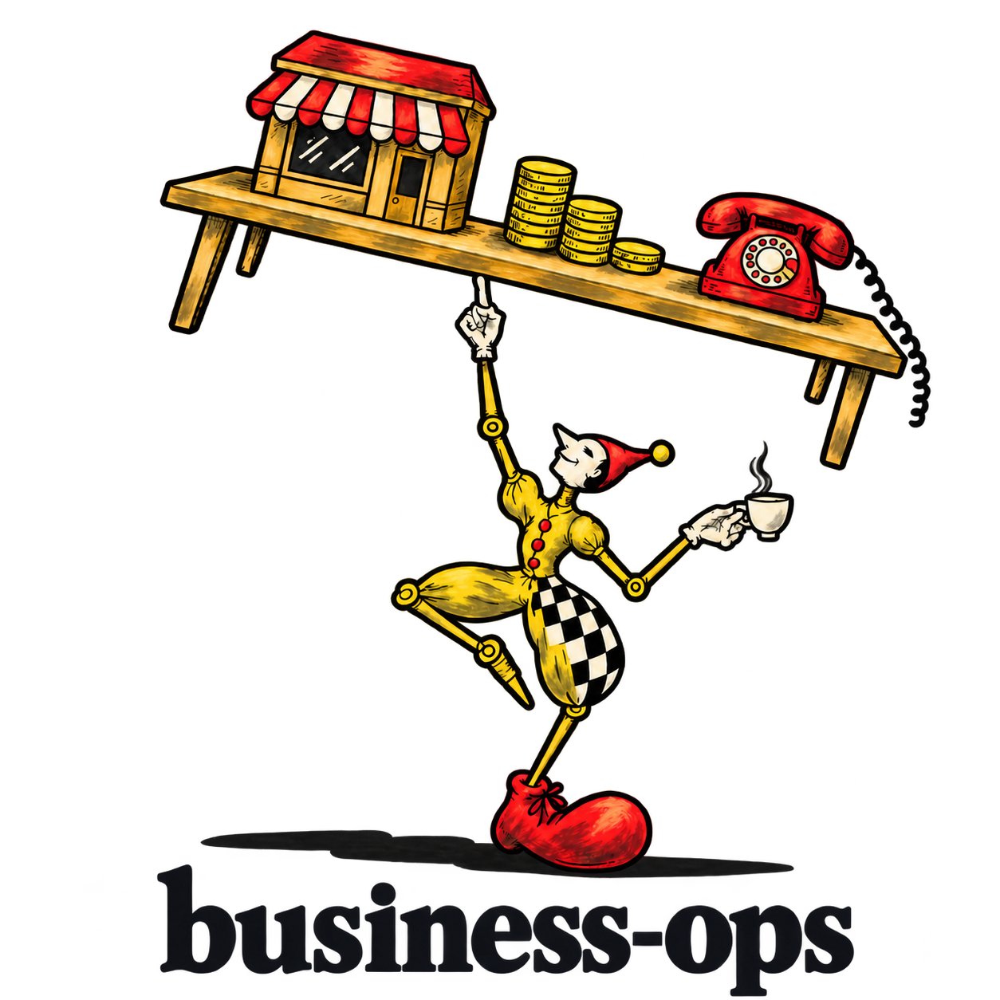
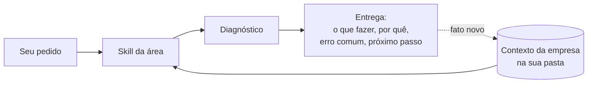

<div align="center">

[English](../../README.md) · **Português (Brasil)**

<picture>
  <source media="(prefers-color-scheme: dark)" srcset="../branding/business-ops-equilibrista-textured-dark.png">
  <source media="(prefers-color-scheme: light)" srcset="../branding/business-ops-equilibrista-textured-light.png">
  
</picture>

### Um plugin para tocar o trabalho de negócios da sua empresa com Claude Code e Codex.

[](#início-rápido)
[](#início-rápido)
[](#o-que-dá-para-fazer)
[](#perguntas-frequentes)
[](../../LICENSE)
[](../../CHANGELOG.md)

[Início rápido](#início-rápido) · [Como funciona](#como-funciona) · [O que dá para fazer](#o-que-dá-para-fazer) · [Exemplos de pedidos](#exemplos-de-pedidos) · [Perguntas frequentes](#perguntas-frequentes) · [Documentação](#documentação)

<code>claude plugin marketplace add pv-ca/business-ops &amp;&amp; claude plugin install business-ops@pvca</code>

</div>

---

Precisa responder um lead, montar uma proposta, planejar o conteúdo do mês ou entender por que os clientes cancelam? Peça ao seu agente. O business-ops dá a ele o método de cada área e o contexto da sua empresa, e a resposta já vem no formato de quem ensina: o que fazer, por quê, o erro comum e o próximo passo.

O plugin reúne 22 skills para vendas, pós-venda, marketing, redes sociais, processos, finanças e gestão. No primeiro uso ele pergunta sobre você e sobre o que a empresa vende, e guarda as respostas em arquivos Markdown numa pasta do seu computador. Quem tem mais de uma empresa mantém uma pasta para cada, e o plugin não leva preço, cliente ou prática de uma para a outra.

O material que vai para o seu cliente usa apenas o que você confirmou. Cada informação da empresa recebe um de cinco status (confirmada, representada, planejada, hipótese ou desconhecida), e planos e preços vêm de um catálogo que registra se cada um está disponível.

> O plugin ainda é um rascunho em uso pelo autor.

## Início rápido

### Instale no seu agente

Claude Code:

```bash
claude plugin marketplace add pv-ca/business-ops
claude plugin install business-ops@pvca
```

Codex:

```bash
codex plugin marketplace add pv-ca/business-ops
codex plugin add business-ops@pvca
```

Abra uma sessão nova depois de instalar.

### Diga onde fica o contexto

No Claude Code, configure a pasta em que os arquivos da empresa vão ficar:

```bash
claude plugin configure business-ops@pvca
```

No Codex, escreva o caminho em um arquivo:

```bash
mkdir -p ~/.config/business-ops
echo /caminho/absoluto/da/pasta > ~/.config/business-ops/context-folder
```

Sem nenhum dos dois, o plugin usa a pasta indicada nas instruções do projeto em que você está, e depois o diretório atual.

### Conte sobre a sua empresa

```text
Quero configurar o contexto da minha empresa.
```

A skill `business-context` conversa em blocos curtos, com no máximo três perguntas por vez: seu papel na empresa, o que ela vende e para quem, o estágio em que está, a principal dificuldade e quanto você conhece de cada área. Se você tiver um documento que já explica a empresa, mande, e ela lê antes de perguntar.

### Peça ao agente

```text
Um lead perguntou o preço e sumiu depois que respondi. Como eu retomo essa conversa?
```

As skills são acionadas pelo próprio pedido. Também dá para chamá-las pelo nome: `/business-ops:sales` no Claude Code, `$sales` no Codex.

### Atualize

```bash
claude plugin marketplace update pvca
claude plugin update business-ops@pvca
```

No Codex, rode de novo `codex plugin add business-ops@pvca`. As mudanças valem a partir de uma sessão nova. O que mudou em cada versão está no [histórico](../../CHANGELOG.md).

## Como funciona

O agente recebe o seu pedido e escolhe a skill da área. Antes de responder, ela lê o perfil e os arquivos da empresa em questão, segue um protocolo comum a todas as skills e só então aplica o método.



O protocolo define quatro coisas. A primeira é o que pode ser afirmado: material para cliente usa fatos confirmados e itens do catálogo marcados como disponíveis. A segunda é a ordem do trabalho, com o diagnóstico antes da recomendação e uma recomendação principal, que traz a primeira ação e o critério para saber se funcionou. A terceira é a profundidade, ajustada ao nível que você informou em cada área. A quarta é o limite das ações: enviar mensagem, publicar, gastar dinheiro ou assumir compromisso em seu nome depende do seu aval para aquela ação, então o plugin entrega o texto pronto e você envia.

Quando você conta algo novo, como um lançamento ou uma mudança de preço, a skill registra no arquivo certo com a data.

## O que dá para fazer

| Área | O que você recebe | Skill |
| --- | --- | --- |
| Contexto | Perfil seu e um conjunto de arquivos por empresa, atualizados quando algo muda | `business-context` |
| Vendas | Resposta a leads, roteiro de conversa e de demonstração, follow-up, resposta a objeção de preço | `sales` |
| Receita recorrente | Funil, métricas, divisão de papéis e avaliação de quando escalar | `recurring-revenue` |
| Pós-venda | Plano de implantação, acompanhamento, resposta a pedido de cancelamento, renovação e indicação | `customer-success` |
| Pesquisa | Roteiro de entrevista, análise de anotações, validação de público e de oferta, concorrentes | `market-research` |
| Marca e oferta | Posicionamento, proposta de valor, desenho de planos e preço, guia de tom de voz | `brand-offer` |
| Propostas | Proposta comercial, apresentação e folha de planos a partir dos modelos da empresa | `proposals-presentations` |
| Marketing | Escolha de canais, plano de uma página e lista de experimentos | `marketing` |
| Redes sociais | Estratégia, pilares, calendário permanente, posts, carrosséis e roteiros de vídeo curto | `social-media` |
| Anúncios | Estrutura de campanha, textos, plano de testes e leitura de resultados | `ads` |
| Parcerias | Escolha de criadores e parceiros, briefing, proposta e acordo de indicação | `creators-partners` |
| Vídeo | Roteiro, plano de cenas e vídeo em motion renderizado | `motion-video` |
| Processos | Procedimento, checklist, política, manual e auditoria da documentação | `processes-docs` |
| Sistemas | Escolha e especificação de CRM, planilha e automação | `systems` |
| Gestão | Prioridades, metas, plano anual ou trimestral e rotina de reuniões | `management-strategy` |
| Finanças | Caixa, margem, preço, ponto de equilíbrio e custo por cliente explicados em linguagem simples | `finance` |
| Lançamentos | Catálogo e histórico atualizados, com a lista de materiais que citam o que mudou | `product-update` |
| Diagnóstico | Nota por tema de uma área, com a evidência, e as três prioridades | `diagnosis` |
| Plano de 90 dias | Metas mensuráveis, tarefas por semana, responsáveis e ritmo de revisão | `quarterly-plan` |
| Aprender | Miniaula de um conceito com exemplo da sua empresa e um exercício | `teach` |
| Decisões difíceis | Seis conselheiros com ângulos opostos respondem de forma independente, um revisor confere quando há conflito que muda a decisão, e o presidente do conselho dá um veredito com o primeiro passo | `llm-council` |
| Revisão | Crítica de um material, trechos reescritos e conferência das afirmações com o contexto | `material-review` |

No Claude Code há ainda quatro atalhos que só encaminham para uma skill: `/business-ops:context`, `/business-ops:proposal`, `/business-ops:presentation` e `/business-ops:process`. O Codex não carrega comandos de plugin, então lá você chama a skill correspondente:

| Atalho no Claude Code | Skill no Codex |
| --- | --- |
| `/business-ops:context` | `$business-context` |
| `/business-ops:proposal`, `/business-ops:presentation` | `$proposals-presentations` |
| `/business-ops:process` | `$processes-docs` |

## Exemplos de pedidos

### Um cliente quer cancelar

```text
O cliente mandou mensagem dizendo que quer cancelar. O que eu respondo?
```

A skill `customer-success` lê o contexto da empresa, pergunta o que falta saber sobre o caso e entrega a resposta pronta para enviar. Junto vem o motivo da abordagem, o erro mais comum nesse tipo de conversa e o que observar depois. A resposta tem este formato:

```text
O que fazer
  Responda hoje e pergunte o que mudou antes de oferecer qualquer coisa. [mensagem pronta para copiar]

Por quê
  O motivo dito no cancelamento raramente é a causa. Sem saber a causa,
  o desconto resolve o problema errado.

Erro comum
  Abrir com desconto. Isso ensina ao cliente que pedir para sair baixa o preço.

Próximo passo
  Envie a mensagem hoje. Se a causa for falta de valor percebido, marque 20 minutos
  nesta semana para mostrar o que ele ainda não usou. Funcionou se ele contar o motivo real.
```

### O conteúdo do mês

```text
Nosso Instagram está parado. Monta o calendário das próximas quatro semanas.
```

A skill `social-media` começa pelo objetivo e pela voz da empresa, propõe os pilares e apresenta o calendário para você aprovar. As peças só são escritas depois da aprovação, e o calendário fica salvo para ser estendido no mês seguinte.

### Um preço mudou

```text
O plano básico subiu para R$ 129 a partir de hoje.
```

A skill `product-update` atualiza o catálogo, registra a mudança com a data no histórico e lista os modelos de proposta e de mensagem que ainda citam o valor antigo.

## Perguntas frequentes

<details>
<summary><strong>Em quais agentes o plugin funciona?</strong></summary>

Claude Code e Codex, a partir da mesma fonte. As skills funcionam nos dois. Os quatro atalhos e a configuração da pasta de contexto pelo plugin existem só no Claude Code.

</details>

<details>
<summary><strong>Onde ficam os dados da minha empresa?</strong></summary>

Na pasta de contexto, no seu computador, em arquivos Markdown que você pode abrir e editar. O plugin não contém dado de nenhuma empresa e não envia nada para fora por conta própria. O que você conversa com o agente segue a política de dados do Claude Code ou do Codex.

</details>

<details>
<summary><strong>Como é a pasta de contexto?</strong></summary>

```
<pasta de contexto>/
  business-ops-context.md         perfil e índice das empresas
  <empresa>/context.md            identidade, posicionamento, o que está confirmado
  <empresa>/catalog.md            planos, preços e recursos, cada um com status
  <empresa>/changelog.md          histórico de lançamentos e mudanças
  <empresa>/method-adaptation.md  como os métodos gerais se aplicam a esta empresa
  <empresa>/templates/            modelos de proposta, apresentação e mensagem
  <empresa>/processes/            procedimentos, políticas e manuais, com índice
  <empresa>/social/               estratégia, voz e calendário de redes sociais
  <empresa>/deliverables/         rascunhos, uma pasta por pedido
  <empresa>/archive/              registros antigos, tirados dos arquivos que crescem
  brand/<empresa>/identity.md     cores, tipografia, uso do logo e tom
  brand/<empresa>/assets/         cópia local do logo e dos arquivos da marca
```

Os arquivos são criados quando a empresa precisa deles pela primeira vez.

</details>

<details>
<summary><strong>Tenho mais de uma empresa. Funciona?</strong></summary>

Sim. Cada empresa tem a sua pasta e o seu arquivo de contexto. Quando a resposta muda conforme a empresa, o plugin pergunta de qual você está falando antes de continuar.

</details>

<details>
<summary><strong>O plugin envia mensagens ou publica por mim?</strong></summary>

Não. Ele entrega o texto pronto para copiar. Enviar, publicar, gastar dinheiro ou assumir um compromisso em seu nome depende do seu aval para aquela ação específica.

</details>

<details>
<summary><strong>Em que idioma ele responde?</strong></summary>

No idioma em que você escrever. Se preferir outro, diga uma vez e ele fica registrado no seu perfil. O material para clientes sai no idioma dos clientes daquela empresa. Os arquivos de instrução das skills estão em inglês, o que não afeta a resposta.

</details>

<details>
<summary><strong>De onde vêm os métodos?</strong></summary>

Quatro skills trazem um playbook próprio: vendas, receita recorrente, sucesso do cliente e pesquisa com clientes. As demais indicam de onde vem cada método.

Para o que muda rápido, como regras de plataformas de anúncio e de redes sociais, preços de mercado, leis e tributos, as skills mandam pesquisar na web e citar a fonte com a data.

</details>

<details>
<summary><strong>Preciso instalar mais alguma coisa?</strong></summary>

Não. O plugin é feito de instruções em Markdown, sem hooks e sem servidores MCP, então nada roda sozinho.

Duas skills trazem um pequeno script Python para os passos em que o resultado exato importa: a `finance` calcula ponto de equilíbrio, economia unitária e projeção de caixa, e a `business-context` confere a estrutura da pasta de contexto. Eles usam só a biblioteca padrão do Python, leem as entradas e imprimem o resultado, sem gravar nos seus arquivos nem usar a rede. O agente pede para rodá-los como qualquer outro comando. Sem Python, as skills fazem o mesmo trabalho lendo os arquivos e mostrando a conta.

Alguns plugins e skills combinam com ele e são opcionais. A skill `motion-video` usa o `hyperframes`, da HeyGen, para animar e renderizar os vídeos, e a `ffmpeg-skill` para cortes e legendas depois da renderização. Quando o `marketing-skills`, de Corey Haines, está instalado, as skills de marketing e de redes sociais passam a ele a execução detalhada. A `proposals-presentations` usa as skills de documento `pptx`, `docx` e `pdf` para montar o arquivo final, e a `social-media` passa os rascunhos pela `humanizer`. Sem nenhum deles as skills continuam funcionando e avisam o que ficou de fora.

</details>

<details>
<summary><strong>Ele substitui um contador ou um advogado?</strong></summary>

Não. Em assuntos jurídicos, trabalhistas, tributários, de privacidade ou de segurança, o plugin explica a consequência para o negócio, separa fato de interpretação e avisa quando é caso de procurar um profissional habilitado.

</details>

## Documentação

- [Notas técnicas do plugin](../../business-ops/README.md): estrutura, regras para manter as skills funcionando nos dois agentes e plugins que combinam. Em inglês.
- [Protocolo comum](../../business-ops/skills/business-context/references/coach-protocol.md): como as skills encontram o contexto, o que pode ser afirmado e o formato da entrega.
- [Formatos de contexto](../../business-ops/skills/business-context/references/context-formats.md): a estrutura de cada arquivo da pasta de contexto e do registro de um lead.
- [Skill de contexto](../../business-ops/skills/business-context/SKILL.md): a conversa de entrada e o que cada arquivo de empresa guarda.
- [Histórico de versões](../../CHANGELOG.md).

A estrutura do repositório:

```
.claude-plugin/marketplace.json   catálogo de onde o plugin é instalado
business-ops/                     o plugin
  .claude-plugin/plugin.json      manifesto e versão
  .codex-plugin/plugin.json       o que o Codex mostra sobre o plugin
  skills/<nome>/SKILL.md          uma pasta por skill, com suas referências
  skills/<nome>/scripts/          script opcional que a skill roda (Python, biblioteca padrão)
  commands/                       atalhos do Claude Code
docs/readme/                      este README em outros idiomas
scripts/validate.py               conferências que rodam a cada push
scripts/bump_version.py           sobe a versão e abre a entrada do changelog
tests/                            testes dos scripts das skills
AGENTS.md                         regras para alterar o plugin
CHANGELOG.md
```

## Contribuir

Abra uma [issue](https://github.com/pv-ca/business-ops/issues) contando o pedido que fez, o que a skill respondeu e o que esperava.

## Licença

[MIT](../../LICENSE)
